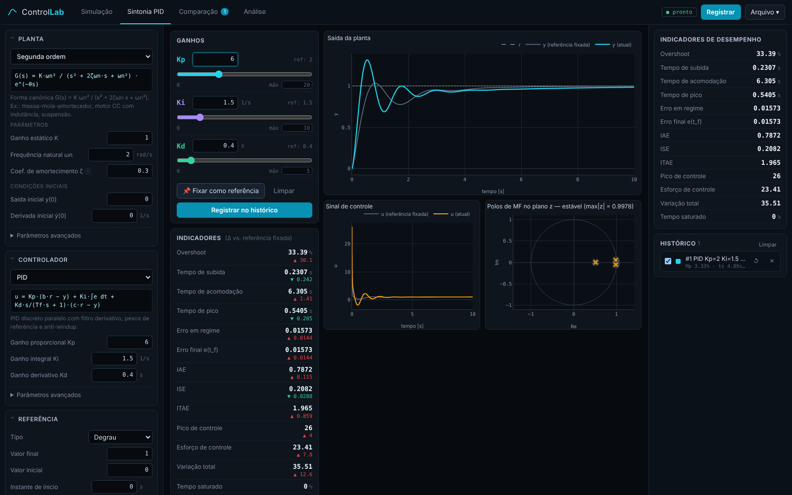

# ControlLab — Laboratório Virtual de Sistemas de Controle

[](https://github.com/Victor-alrib/controllab/actions/workflows/ci.yml)

Aplicação web para configurar uma planta dinâmica, escolher um controlador (malha aberta, P, PI ou PID), ajustar os parâmetros e ver a resposta simulada, os indicadores de desempenho e a análise de estabilidade. Os cálculos são verificados contra soluções analíticas por testes automatizados.



## Problema

Em disciplinas de controle, boa parte do entendimento vem de mexer num ganho e ver o que acontece. As alternativas costumam ser licenças caras (MATLAB/Simulink), scripts soltos ou simuladores didáticos que não deixam claro como os números foram calculados.

O objetivo foi um laboratório virtual com interface moderna e **fidelidade matemática verificável**: cada número na tela vem de uma simulação numérica real, não de animação nem de aproximação escondida.

## Abordagem

O projeto é um motor de simulação numérica com interface web; não há dataset nem modelo treinado.

| Escolha | Por quê |
|---|---|
| **Planta contínua + controlador discreto (amostrado a cada Ts)** | É assim que um controlador digital real funciona; o efeito do tempo de amostragem aparece nos resultados. |
| **Integração exata por ZOH** (`Φ = e^{Ah}`, via exponencial de matriz do sistema aumentado, SciPy `expm`) | Com entrada constante entre amostras a solução é exata, sem erro de método numérico (Euler, Runge-Kutta). |
| **PID com equações de diferenças documentadas** e suas funções de transferência em z | Os polos discretos mostrados na aba Análise são exatamente os da malha simulada; há teste que verifica isso. |
| **Anti-windup** (*clamping* e *back-calculation*), filtro derivativo, pesos de referência b/c | Recursos de um PID real que mudam o comportamento quando há saturação e ruído. |
| **Análise linear com python-control** (polos, Bode, margens com atraso exato `e^{-jωθ}`) | Liga o que se vê no tempo com o que a teoria prevê na frequência. |
| **Arquitetura por registro + `ParamSpec`** | Cada planta/controlador declara seus parâmetros; o backend valida e o frontend gera os formulários sozinho. Adicionar um modelo não exige mexer na interface. |
| **FastAPI (Python) + React/TypeScript** | O ecossistema científico está em Python; a interface interativa, em TypeScript tipado. |
| **Gráficos Plotly** | Zoom, pan, hover e exportação de PNG, necessários para inspecionar respostas. |

**Funcionalidades:** plantas de 1ª e 2ª ordem, função de transferência e espaço de estados (com condições iniciais e atraso de transporte); referência degrau, rampa, senoide, quadrada ou constante; perturbações na entrada ou na saída; ruído de medição com semente; saturação do atuador; histórico e comparação de execuções; laboratório de sintonia PID com sliders; exportação de configuração (JSON), dados (CSV) e relatório (HTML).

## Resultados

### Verificação numérica

**25 testes automatizados passando** ([saída do pytest](resultados/saida-testes.txt)). Tolerâncias exigidas pelos testes:

| Verificação | Tolerância |
|---|---|
| Resposta ao degrau de 1ª ordem vs. `K(1 − e^{−t/τ})` | erro máx. < 1e-10 |
| Resposta de 2ª ordem (ζ = 0,1; 0,5; 0,9) vs. fórmula fechada | erro máx. < 1e-9 |
| Overshoot vs. `e^{−ζπ/√(1−ζ²)}` | erro relativo < 1e-4 |
| Função de transferência vs. `control.step_response` | erro máx. < 1e-8 |
| Malha PID simulada vs. malha fechada discreta exata (3 discretizações) | erro máx. < 1e-10 |
| Margem de fase com atraso vs. fórmula analítica | < 0,05° |
| IAE, ISE, ITAE vs. valores analíticos (τ, τ/2, τ²) | erro relativo < 1e-4 |
| Erro em regime com controle P vs. `1/(1 + K·Kp)` | < 1e-6 |

### Exemplo: efeito do ganho proporcional

Planta `G(s) = 4/(s² + 1,2s + 4)` (ωn = 2, ζ = 0,3), PID com Ki = 1,5, Kd = 0,4, Ts = 0,01 s, 10 s de simulação:

| Indicador | Kp = 2 | Kp = 6 |
|---|---|---|
| Overshoot | 3,33 % | 33,39 % |
| Tempo de subida (10–90 %) | 0,473 s | 0,231 s |
| Tempo de acomodação (2 %) | 4,89 s | 6,31 s |
| Erro em regime em t = 10 s | 0,0014 | 0,0157 |
| IAE / ISE / ITAE | 0,672 / 0,237 / 1,106 | 0,787 / 0,208 / 1,965 |
| Pico do sinal de controle | 22 | 26 |
| Margem de fase | 52,4° em 3,47 rad/s | 31,5° em 5,36 rad/s |
| Raio espectral da malha discreta | 0,9944 (estável) | 0,9978 (estável) |

Triplicar Kp deixou a subida duas vezes mais rápida, mas o overshoot passou de ~3 % para ~33 %, a margem de fase caiu de 52° para 31° e a acomodação ficou mais lenta, como a teoria prevê.

### Tempo de simulação

Medido chamando a API em um ambiente Linux (planta de 2ª ordem + PID, Ts = 0,01 s; inclui a resposta HTTP):

| Amostras | Tempo por simulação |
|---|---|
| 1.000 | 0,12 s |
| 20.000 | 0,31 s |
| 200.000 (limite configurado) | 2,7 s |

Mais tabelas e capturas de tela em [`resultados/`](resultados/resultados.md).

## Como rodar

Requisitos: Python ≥ 3.10 e Node.js ≥ 18.

```bash
# 1) Backend
cd backend
python -m venv .venv
# Linux/macOS: source .venv/bin/activate     Windows: .venv\Scripts\activate
pip install -r requirements.txt
uvicorn app.main:app --reload --port 8000     # documentação da API em http://localhost:8000/docs

# 2) Frontend (outro terminal)
cd frontend
npm install
npm run dev                                    # abra http://localhost:5173
```

Para rodar tudo num processo só: `npm run build` no frontend e depois apenas o backend, que serve a interface em http://localhost:8000.

Testes: `cd backend && pytest`.

O projeto não usa chaves de API, senhas ou tokens. A única variável de ambiente é opcional: `VITE_API_URL`, para apontar o frontend para um backend em outro endereço.

## Limitações e próximos passos

- **Controladores avançados:** LQR, Modos Deslizantes (SMC) e Super-Twisting aparecem na interface como "planejados". A arquitetura já prevê acesso ao estado da planta; o roteiro está em [`docs/ARQUITETURA.md`](docs/ARQUITETURA.md).
- Só plantas **lineares** SISO. Plantas não lineares (pêndulo, tanque) exigem outro integrador.
- Atraso que não é múltiplo do passo de integração é arredondado (o valor efetivo é exibido); polos contínuos com atraso usam aproximação de Padé.
- A análise linear (polos, margens) ignora saturação.
- O histórico fica no `localStorage` do navegador; não há contas nem banco de dados.
- Próximos passos: comparação numérica com MATLAB/Simulink, testes automatizados do frontend e um ambiente de aprendizado por reforço usando a mesma planta.

## Stack

Python · FastAPI · Pydantic · NumPy · SciPy · python-control · Matplotlib · pytest · React 18 · TypeScript · Vite · Plotly.js · Playwright

## Estrutura

```
backend/app/        core (ParamSpec), plants, controllers, simulation, analysis, report, main.py
backend/tests/      test_fidelity.py (matemática), test_api.py (endpoints)
frontend/src/       components, views (Simulação, Sintonia, Comparação, Análise), api, lib
scripts/            testes ponta a ponta com Playwright
docs/               arquitetura e roteiro de expansão
resultados/         capturas de tela, saída dos testes, relatório de exemplo, tabelas
```

## Autoria

Desenvolvido por **Victor** (Engenharia de Controle e Automação — IFSP), com auxílio de IA (Claude) na escrita do código e da documentação.

## Licença

[MIT](LICENSE)
